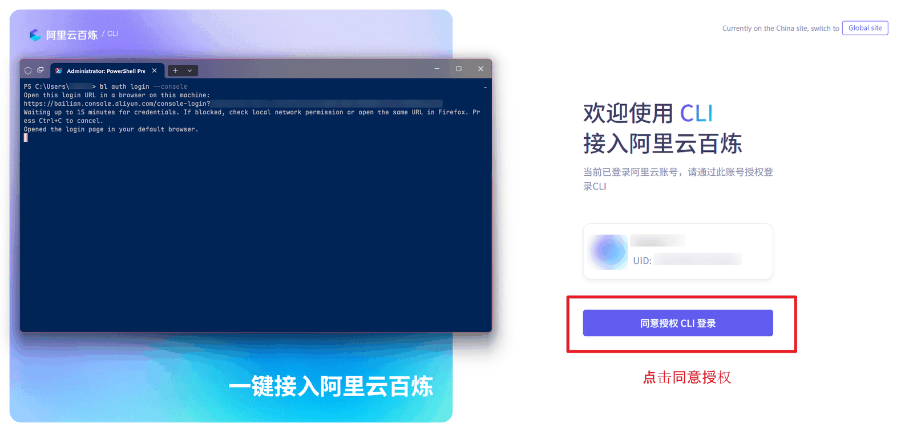

# English Practice (dsh-increasing-my-english)

[中文](README.zh.md) · [Changelog](CHANGELOG.md) · [MIT License](LICENSE)

Transcribe podcast recordings into speaker-diarized transcripts with the Bailian `bl speech recognize` CLI, read them in the DSH right sidebar, and press **Ctrl** on a word or sentence to look it up and keep it in a wordbook with phonetics, meanings, example sentences, word forms and etymology. While the plugin is idle, the wordbook **compares every transcript in the workspace and fills in the word's other senses** automatically. Then open the third view, **Review**, to review those words actively every day, and the fourth view, **Graph**, to see how the transcripts, the words, and the words among themselves connect.

[](https://www.npmjs.com/package/dsh-increasing-my-english)
[](LICENSE)
[](https://deepseek.com/harness)

Requires DSH **>= 0.2.0** (web UI: the desktop app or `dsh web`). Transcription needs a logged-in Bailian CLI; PDF import needs poppler.

## Let an agent set it up (recommended)

Copy this paragraph into a new DSH conversation opened in the folder where you want your English material to live. The agent reads the [detailed setup guide](https://github.com/LeeKai233/dsh-increasing-my-english/blob/main/AGENT_ONBOARDING.md), does everything that does not need your hands, and replies with what is left for you and a 10-minute reading task.

```text
You're my English intensive-reading setup partner inside DSH. Read the detailed guide at
https://raw.githubusercontent.com/LeeKai233/dsh-increasing-my-english/main/AGENT_ONBOARDING.md — or
AGENT_ONBOARDING.md in this repository if it is mounted here — and follow it. Do everything that does not need my hands; stop
only for clicks, logins, a restart, or approvals. Then reply with three short sections: what you finished,
what only I can do (with the exact place to click), and one 10-minute reading task to start with. Do not delete or rewrite my
data, do not send content anywhere except the Bailian ASR call and the plugin's own lookup, and never
echo credentials. If you cannot read the guide, ask me to attach it.
```

Prefer to do it by hand? The three steps below walk through the same setup.

## Get started in 3 steps

1. **Install the DSH desktop app** (DeepSeek official): <https://deepseek.com/harness>.
2. **Install the plugin**: sidebar → **Plugins** → **Add plugin** → enter `dsh-increasing-my-english` → install and enable it.
3. **Set up Bailian**: create an Alibaba Cloud Bailian account and install + log in to the Bailian CLI by following the illustrated guide in [README.zh.md](README.zh.md#百炼-cli-安装与登录图文) (summarized below).

Then open the **English practice** tab in the right sidebar. Once the **Environment check** card in the empty state is all green (it requires `bl` signed in, Poppler and a writable workspace; with existing transcripts the card is also shown while the **Transcribe** panel is open), drop a recording into `recordings/` and start transcribing. As you collect words into the wordbook, open the third view **Review** for one active-recall round a day.

## Install and log in to the Bailian CLI

See the illustrated steps in [README.zh.md](README.zh.md#百炼-cli-安装与登录图文) — the eight screenshots live in [`assets/bailian-cli/`](assets/bailian-cli). In short:

1. Open <https://bailian.console.aliyun.com/cli> (China site), choose **Install CLI** → **Let an Agent install it (recommended)** → copy the prompt and paste it into a new DSH conversation. The assistant runs the official installer and reports the real `bl --version`.
2. Switch to **Authentication** → **Quick login (recommended)** and copy the command `bl auth login --console`.
3. On Windows, open **PowerShell 7** from the Start menu (PowerShell / PowerShell Preview; do **not** use legacy Windows PowerShell 5.1).
4. Paste `bl auth login --console` into PowerShell and press Enter.
5. Your browser opens the Alibaba Cloud login page. After signing in (or signing up) an API key is created automatically; new accounts get free quota and models stop running when the quota is used up unless you top up.
6. Click **Authorize CLI login** on the authorization page.
7. The terminal prints **CLI login successful!** and saves credentials to `…\.bailian\config.json` (i.e. `%USERPROFILE%\.bailian\config.json`).
8. Run `bl usage free` to inspect the free quota (`bl usage free --all` for every model).




**No-terminal path**: just ask the assistant in a new conversation to “install the Bailian CLI” and “log in to the Bailian CLI”. It runs the official installer and `bl auth login --console` in a background terminal; you only complete the browser login and authorization, then the assistant reports the result. The panel's **Environment check** card verifies it.

## Mainland China network

| Step | Recommendation |
|---|---|
| Installing the DSH plugin | The plugin page automatically picks the faster registry between `registry.npmjs.org` and `registry.npmmirror.com`. A freshly published package can take 5–10 minutes to reach npmmirror; if it is not found right after release, retry a few minutes later. |
| Bailian CLI `bl` | Use the official Bailian China-site installer/docs (<https://bailian.console.aliyun.com/cli>), not third-party mirrors. |
| poppler (PDF import) | Prefer `winget install -e --id oschwartz10612.Poppler`; if poppler already exists elsewhere, point `DSH_ENGLISH_PDFTOPPM` / `DSH_ENGLISH_PDFTOTEXT` at the existing `pdftoppm.exe` / `pdftotext.exe`. |
| GitHub | Only developers need it (source, issues, release notes); installing the plugin and logging in the CLI never require direct GitHub access. |

## Features

### Cross-project sharing (top-bar switch)

- The panel toolbar has a **Shared** switch, off by default. Turn it on to make **the current project the shared library**: files stay in that project's folder (nothing is copied or moved), and every other project that opens the panel sees the same transcripts, wordbook, review progress, lookup cache, recordings and PDF pages.
- Turn it off to return each project to its own data; the shared library files stay untouched. To move the library, switch it off, open the target project, and switch it on there.
- While sharing, every project uses the shared library's `.dsh-english/config.json` (transcription model, lookup backend and other settings follow it). Switching is refused while a transcription is running; if the library folder is unavailable, data actions fail but the switch can still be turned off.
- The setting is stored at `~/.dsh/english-practice.json` (`DSH_HOME/english-practice.json` when `DSH_HOME` is set) as `{ "version": 1, "sharedRoot": "<absolute path>" }`; deleting it turns sharing off. Multiple DSH instances writing the same library are best-effort.
- While sharing, the **Transcribe** panel lists the shared library's `recordings/`; to transcribe audio that lives in the current project, use **Choose folder…** or paste its absolute path.
- Keep the shared-library project in place. If its path becomes unavailable, turn the switch off to get back to the current project's data, then repair or re-create it.

### Transcribe recordings

- Put audio in `recordings/` (mp3 / m4a / wav / aac / flac / ogg / opus / amr / wma / mp4 / webm).
- In the **Transcribe** panel, pick a file from `recordings/`, or paste the absolute path of any folder/audio file and click **Scan**, or use **Choose folder…**; then pick a **Model** (default `qwen-audio-3.1-asr-flash-filetrans`, list provided by the host) and optionally the number of speakers (diarization is always on), then click **Start**. Transcription runs in the background, usually 1–3 minutes; the transcript appears automatically when done.
- Or simply ask the assistant in chat: “transcribe recordings/ep12.m4a”; it calls the `english_transcribe` tool and waits for completion.
- The default model is `qwen-audio-3.1-asr-flash-filetrans`; on failure it falls back to `fun-asr` and records the fallback in the transcript's `warnings`.

### Read transcripts

- Open it with the **headphones button** in the conversation header toolbar (tooltip: “Open English practice”), or the “English practice” card in the right-sidebar guide. The panel has a **Transcript / Wordbook / Review** view switch and **A− / A+** font sizing (12–20px, remembered separately for each view).
- Opening the panel shows the **transcript you last opened** (remembered in browser storage, so it survives page refreshes and session switches); only when that file was deleted or is not in the current workspace does it fall back to the newest transcript.
- When transcripts exist, a dropdown at the top (“Choose a transcript”) switches between them; transcripts are grouped by speaker with per-segment timestamps.
- Imported transcripts have no speakers or timestamps and do not show **Merge short sentences**; PDF transcripts also get zoom (+ / −, remembered) and a **Preview** button that opens the original PDF inside DSH.

### Ctrl lookup

- Select a **word/phrase (≤4 words)** or a **sentence** in the transcript and press **Ctrl** (**⌘** on macOS):
  - word/phrase: a popover with phonetics and 1–3 Chinese meanings (word forms and etymology live on the wordbook card after adding);
  - sentence: a popover with the Chinese translation only.
- Words already in the wordbook get a **dashed underline**; selecting them reuses the saved phonetics and meanings (and the saved translation for sentences) and **skips the model call**. New lookups are cached in `.dsh-english/lookup-cache.json`.

### Wordbook

- Add from the popover's top-right button; duplicates are not inserted twice. Failed lookups are stored as “needs details” entries that you can complete later.
- Word entries automatically carry:
  - **word forms**: other parts of speech and irregular forms (past tense, past participle, plural, comparative, superlative, present participle, third-person singular, …), **up to 8**;
  - **etymology**: source language + root/affix breakdown + a short Chinese explanation.
- Older entries missing those fields show a **Fetch forms & etymology** button (HTTP `vocab.enrich`, tool `action=enrich`).
- **Automatic multi-sense completion**: when the plugin is idle (panel closed/hidden, no request for about 3 minutes), a background pass runs the wordbook words through **every transcript in the workspace**, asks the lookup backend for the senses actually used in those contexts, and appends the meanings found in other documents to the entry. New senses carry a **context example** and **source transcript** evidence; existing meanings are never overwritten (up to 8 meanings). Words with fewer than 2 contexts are only marked “no other contexts” and never cost a model call. Only a changed corpus/word-forms/original sentence (or a due retry) re-analyses a word, so idle time does not burn the model repeatedly. The card shows **Senses analyzed: N contexts · M transcripts**, and an **Analyze senses** button forces one word immediately (HTTP `vocab.analyze`, tool `action=analyze`).
- **Duplicate meanings are folded**: near-duplicate senses coming from the dictionary and the multi-sense analysis collapse into one line (`v. 介入；干预；调停` + `v. 介入；干预`, `n. 丑闻` + `n. 丑闻（尤指性丑闻）`), keeping the fuller wording and its example/source; parts of speech only merge when one explanation strictly contains the other, so `n. 增加` and `v. 增加` stay separate. The wordbook card, the review card, the graph detail, the lookup popover, `vocab/生词本.md` and the assistant's list all use the same rule; stale duplicates are persisted away the next time an entry is rewritten.
- The wordbook view supports search, word/sentence filtering, transcript filtering, sorting (time / A–Z), Full/Simple detail and deletion; when pending entries exist a banner with a **Copy prompt** button appears — paste it into the chat and the assistant reads pending entries with `english_vocab` and writes phonetics/meanings/translations back.
- `vocab/生词本.md` is a readable export rewritten after every change.

### Review

- The third view, **Review**, turns wordbook **words** into active-recall practice: **EN → ZH** (see the word and its phonetics, write the Chinese meaning), **ZH → EN** (see the meanings, write the word) and **Mixed** (the two alternate within one round). Sentence entries are never included, and words without a Chinese meaning are skipped.
- Each word has a mastery level from **0 to 5** (Fresh → Started → Learning → Familiar → Solid → Mastered). After submitting an answer you see the auto-check verdict (correct / close / incorrect — a hint only) and the correct answer, then self-grade **Forgot / Fuzzy / Got it / Easy** (buttons, shortcuts **1–4**; Enter takes the recommended grade). Mastery moves with the grade and the next review is scheduled **1 / 1 / 2 / 4 / 7 / 15 days** out; a missed word is never shown twice on the same day.
- The first time you open Review on a day it prepares a **fixed round for that day**: due words first (ordered by due date, then mastery), topped up with up to the **daily new-word limit**, capped by the **daily question limit**. Reopening it later the same day keeps the same round — no reshuffle, no additions; words added to the wordbook after that day's round exists join tomorrow.
- Stuck? Use **Don’t know — show the answer**. The card also has a **Show example** toggle that reveals the example sentence containing the word (masked to same-length underscores in ZH → EN so it does not give the answer away; when the wordbook entry has no example it says so). After you submit, the example and its translation are shown in the answer area too. When the round is done you get today’s completion count and correct answers, streak days, and the last 14 days. **Mastery** is a separate page: switch to it with the **Today / Mastery** tabs at the top (it no longer stacks under the practice card). Its table sorts by mastery and lists **word / mastery bar / level / next review / actions** (each column left-aligned); a word can be reset individually and the whole progress can be reset at the bottom.
- Deleting a wordbook entry cleans up its review state lazily on the next read; progress lives in `.dsh-english/recall.json`, and deleting that file starts from scratch.
- The practice direction can be switched at any time and is remembered in the browser; `recall.mode` in the host config is only the default for the first visit.

### Graph

- The fourth view, **Graph**, draws how the material connects: **transcript nodes** (your podcasts and imported documents) and **word nodes** (the wordbook's words), joined by four kinds of links — all derived locally, with no model call and nothing written to disk:
  - **occurs / source** (transcript ↔ word): the word (and its word forms; case-insensitive, apostrophes and hyphens normalized) actually appears in that transcript. The transcript a word was captured from is marked **source** and carries the sentence it was saved from; the other transcripts show how many times the word occurs there.
  - **same sentence** (word ↔ word): the two words are used in the same sentence of a transcript.
  - **root / family** (word ↔ word): they share a meaningful etymology root (affixes such as `ad-` / `in-` are ignored) or a word form one of them lists.
  - **shared meaning** (word ↔ word): their Chinese meanings contain the same fragment.
- Interactions: **drag** a node, **scroll** or use **+ / −** to zoom, **Reset view** to fit everything; the segmented control filters to transcript ↔ word or word ↔ word links only; the **search box** finds a word or transcript and centres it; clicking a node opens a **detail panel** (meanings, mastery ring, example, related transcripts and words) where **Open transcript** jumps to the reader with that file selected and **Only this transcript** narrows the graph to one transcript's words.
- The graph is read-only and recomputed from `transcripts/`, `vocab/vocabulary.json` and the review progress on every visit; it stores no new file. Deleting a word or a transcript removes its node and links on the next visit. On a very large workspace the view keeps the most connected words and transcripts and reports how many it trimmed.

### PDF import

- **Import transcript** accepts `.txt` / `.text` / `.md` / `.markdown` / `.html` / `.htm` / `.tex` / `.rst` / `.log` (≤3MB) and `.pdf` (≤20MB, up to 120 pages rendered by default).
- HTML is stripped of tags, Markdown of markup; TeX commands are removed while `$…$` math is kept (rendered in the sidebar).
- PDFs are displayed page by page: local `pdftoppm` renders page images and `pdftotext -bbox` supplies a word-coordinate text layer, so you can select words and press Ctrl exactly like in a transcript.
- **PDF import requires poppler** (`pdftoppm` / `pdftotext`); when missing, import fails and the **Environment check** card shows the `winget install -e --id oschwartz10612.Poppler` command.

### Merge short sentences / delete

- **Merge short sentences** (transcribed transcripts only): adjacent segments from the same speaker separated by no more than `asr.mergeGapMs` (default 4000ms) are merged into paragraphs; transcription applies this automatically.
- **Delete** asks for a second confirmation; it removes `transcripts/<name>.json`, matching job records and PDF page cache only — **your audio files are never touched**.

### Environment check

- The **Environment check** card appears when there is no transcript yet (empty state) or while the **Transcribe** panel is open (its data comes from `env.check`; nothing is probed locally). It is collapsed by default and only auto-expands once when a problem is detected; click the title to expand/collapse it manually.
- Status chips: `bl` (Ready / Missing / not signed in, with the version when expanded), `PDF` (Ready / Missing, i.e. Poppler), `Workspace` (Ready / not writable); when **Shared** is on, a fourth `Shared library` chip (Ready / unavailable).
- Expanded, it shows details for `bl`, `PDF tool (Poppler)` and `Workspace`, the status of the `transcripts` / `vocab` / `recordings` directories and writability, a Notes (warnings) list, and a **Check again** button.
- Copy-paste fixes appear only for what is missing: `bl` missing → `npm i -g bailian-cli --registry=https://registry.npmmirror.com`; `bl` not signed in → `bl auth login --console`; Poppler missing → `winget install -e --id oschwartz10612.Poppler` (Linux/macOS: `brew install poppler` / `sudo apt install poppler-utils`). Click **Check again** afterwards. Note: **Poppler only affects PDF import** — without it, transcription and lookup still work, but the check will not be all green (the `PDF` chip shows Missing).

## Workspace layout

```
<workspace>/
  recordings/                     your audio files (read-only for the plugin)
  transcripts/<name>.json         normalized transcript (segments + ms timestamps)
  transcripts/.jobs/<id>.json     job state (15s heartbeat; stale after 90s = interrupted)
  transcripts/.jobs/<id>.raw.json raw ASR output
  vocab/vocabulary.json           wordbook source of truth (words + sentences)
  vocab/生词本.md                  readable export rewritten on every change
  .dsh-english/config.json        optional configuration overrides
  .dsh-english/lookup-cache.json  lookup cache
  .dsh-english/recall.json        recall progress (mastery, daily rounds; cleaned up when entries are deleted)
  .dsh-english/pdfs/<uuid>/       PDF cache (source.pdf / page-XX.png / words.xml)
```

With the **Shared** switch on, all of these directories live in the shared-library project; switch it off to use each project's own directories. The library folder is never copied or moved.

The data format is frozen at `version: 1` (only optional fields may be added); the recall progress file `.dsh-english/recall.json` is a separate new data file, also at `version: 1`. Corrupt JSON is backed up as `*.corrupt-<timestamp>` and the default is used instead.

## Configuration

`.dsh-english/config.json` is optional; defaults apply when it is missing:

```json
{
  "asr": {
    "model": "qwen-audio-3.1-asr-flash-filetrans",
    "fallbackModel": "fun-asr",
    "language": "en",
    "maxJobMinutes": 30,
    "pollIntervalSeconds": 2,
    "mergeGapMs": 4000,
    "toolTimeoutMinutes": 32
  },
  "lookup": {
    "backend": "ds",
    "provider": null,
    "model": null,
    "timeoutMs": 20000
  },
  "import": {
    "maxPdfPages": 120,
    "dpi": 100
  },
  "dirs": {
    "recordings": "recordings",
    "transcripts": "transcripts"
  },
  "recall": {
    "newPerDay": 10,
    "dailyLimit": 30,
    "mode": "mix"
  },
  "analysis": {
    "enabled": true,
    "idleMinutes": 3,
    "batchWords": 2,
    "maxContexts": 6,
    "maxContextChars": 240,
    "timeoutMs": 30000,
    "retryMinutes": 10
  }
}
```

The host caches the config for about 2 seconds: edits take effect after a moment, no DSH restart needed.

| Key | Default | Meaning |
|---|---|---|
| `asr.model` | `qwen-audio-3.1-asr-flash-filetrans` | default transcription model |
| `asr.fallbackModel` | `fun-asr` | fallback when the primary model fails; empty string disables it |
| `asr.language` | `en` | language hint (`zh`, …) |
| `asr.maxJobMinutes` | 30 | maximum runtime of one transcription job |
| `asr.pollIntervalSeconds` | 2 | polling interval for `bl speech recognize` |
| `asr.mergeGapMs` | 4000 | auto-merge threshold for adjacent segments of the same speaker |
| `asr.toolTimeoutMinutes` | 32 | overall timeout of the `english_transcribe` tool; must exceed `maxJobMinutes` |
| `lookup.backend` | `ds` | `ds` (current DSH model; fast, no Bailian text quota) / `bl` (`bl text chat`) / `off` |
| `lookup.provider` / `lookup.model` | `null` | override the lookup model; `null` follows the DSH default model |
| `lookup.timeoutMs` | 20000 | per-lookup timeout in milliseconds |
| `import.maxPdfPages` | 120 | maximum pages rendered for PDF import |
| `import.dpi` | 100 | PDF page rendering resolution |
| `dirs.recordings` / `dirs.transcripts` | `recordings` / `transcripts` | relative directories inside the workspace |
| `recall.newPerDay` | 10 | max new words introduced per day; `0` reviews due words only |
| `recall.dailyLimit` | 30 | max questions in one daily round |
| `recall.mode` | `mix` | practice direction for the first visit: `mix` / `en-zh` (English → Chinese) / `zh-en` (Chinese → English); changes in the panel are remembered in the browser |
| `analysis.enabled` | `true` | run the automatic background pass; `false` stops it (the card's **Analyze senses** button and `action=analyze` still work) |
| `analysis.idleMinutes` | 3 | how long the workspace must be free of plugin requests before a background batch starts (0.5–120) |
| `analysis.batchWords` | 2 | max words analysed per background batch (1–20); batches are 20s apart |
| `analysis.maxContexts` / `analysis.maxContextChars` | 6 / 240 | context sentences per word and their max length in the prompt |
| `analysis.timeoutMs` | 30000 | timeout of one sense-analysis model call (5000–120000) |
| `analysis.retryMinutes` | 10 | how long a failed analysis waits before it is retried (1–1440) |

**Executable paths are not configurable through the config file.** `config.json` lives in the (writable) workspace, so to keep it from becoming an execution vector, `bl`, `pdftoppm` and `pdftotext` can only be overridden through **read-only environment variables** (absolute path or bare command name; no spaces, arguments or shell metacharacters):

| Environment variable | Default command | Purpose |
|---|---|---|
| `DSH_ENGLISH_BL` | `bl` | Bailian CLI |
| `DSH_ENGLISH_PDFTOPPM` | `pdftoppm` | PDF page rendering (poppler) |
| `DSH_ENGLISH_PDFTOTEXT` | `pdftotext` | PDF word-coordinate text layer (poppler) |

The legacy keys `blPath`, `import.pdfToPpmPath` and `import.pdfToTextPath` are removed: they are ignored and reported as warnings in the **Environment check** card with the matching environment variable. Unknown keys are ignored; invalid values fall back to defaults with a warning. On Linux/macOS install poppler with `brew install poppler` or `sudo apt install poppler-utils`.

## Agent tools

- `english_transcribe { audio, speakers?, model?, language? }` — transcribe and wait; returns `{ok,jobId,transcript,segments,speakers,durationMs,model,warnings,state,error?}`. `audio` may be relative to the current workspace or shared library, or absolute. Failures are actionable (install/login commands when `bl` is missing or not logged in).
- `english_vocab { action, ... }` — `action` is one of `list` (defaults to pending entries) / `lookup` / `add` / `update` / `enrich` / `analyze` / `remove` / `export`. `analyze` (optional `id`) compares every transcript for the word, appends the other senses with context/source evidence and returns `{analyzed,updated,added,skipped,failed,remaining,entries}`. Without `id` one call analyses at most `analysis.batchWords` stale words (default 2); repeat while `remaining > 0`.
  - `list` defaults to pending entries; `update` lets the assistant fill phonetics/meanings/example translations itself; `enrich` re-queries word forms and etymology by id; `export` rewrites `vocab/生词本.md`.
- The panel and the assistant share the same Host implementation: panel actions (transcript list, transcription, lookup, wordbook, …) call `POST /dsh-english/api` (loopback only with the `x-english-practice: 1` header; a browser `Origin` must be local), transcript and wordbook bodies and PDF page images are read through plugin HTTP actions (`transcripts.read` / `vocab.read` / `pdf.page`) so they also work when the shared library lives in another project, and the assistant calls the two tools above.

## FAQ

**It cannot find `bl` / says the CLI is not logged in.**
The error code is `bl/missing` or `bl/not-authenticated`. The **Environment check** card (shown in the empty state, or while the **Transcribe** panel is open) points at the missing step. Manual fix: `npm i -g bailian-cli --registry=https://registry.npmmirror.com`, then `bl auth login --console`, then `bl auth status`. Restart DSH afterwards so the process picks up the new `PATH`. Other common codes: `pdf/poppler-missing` (no poppler), `http/rate-limited` (too many requests), `config/invalid` (config unreadable).

**PDF import fails with `pdf/poppler-missing`.**
Install poppler with `winget install -e --id oschwartz10612.Poppler`; if it is installed in a non-default location, set `DSH_ENGLISH_PDFTOPPM` / `DSH_ENGLISH_PDFTOTEXT`. Restart DSH afterwards.

**How do I write Windows paths?**
Use absolute paths such as `D:\Podcasts\ep12.m4a`. Paths with spaces can be pasted directly into the **Scan** field — no quotes, no escaping needed.

**What does it cost?**
Transcription calls Bailian ASR and is billed at Bailian prices; audio is uploaded to Bailian temporary storage (kept for 48h). Check the free quota with `bl usage free`; without top-up, models stop when the quota is used up. Lookups use the current DSH model by default (`ctx.llm`) and cost no Bailian text quota; only `lookup.backend = "bl"` routes lookups through Bailian text models.

**Why does an entry have no meaning yet?**
Failed lookups are stored as “needs details”. Click **Fetch forms & etymology** on the card, or ask the assistant to “complete the pending wordbook entries”.

**When does the multi-sense analysis run, and does it cost extra?**
By default it runs in the background after the plugin has been idle for about 3 minutes — the panel does not need to be open. You can also click **Analyze senses** on a card or ask the assistant for `action=analyze`. It uses the same backend as lookups (the current DSH model by default; Bailian text models when `lookup.backend = "bl"`), analyses only stale words, and never repeats a model call while the corpus is unchanged. Stop the background pass or tune `idleMinutes` / `batchWords` in the `analysis` section of `.dsh-english/config.json`; `enabled: false` does not block the manual **Analyze senses** button or the tool action.

**Privacy.**
No telemetry. Transcripts, the wordbook and the cache are plain files in your workspace (or in the shared-library project you explicitly turned on). The HTTP endpoint listens on loopback only, requires a custom request header, and rejects a non-local `Origin` when the browser sends one. The sharing switch stores only one absolute path in `~/.dsh/english-practice.json` and uploads nothing.

**Uninstall / switch source.**
The desktop plugin row is owned by the Electron profile: use **Remove** then **Add** in the plugin page instead of editing the manifest by hand. Removing the plugin keeps your workspace data.

## Repository layout

| Path | Purpose |
|---|---|
| `index.js` | Plugin entry: `name` / `inject` / `apply(ctx)`, assembly only (~22 lines) |
| `host/` | Host half, 16 modules: `analysis` / `api` / `asr` / `config` / `env` / `graph` / `json-store` / `lookup` / `paths` / `pdf` / `recall` / `senses` / `text` / `tools` / `transcript` / `vocab` |
| `client.js` | Client half: single-file `window.__ModuleLoader__.load` bundle (§0–§9 partitions) |
| `cordis.patch.yml` | Bundle patch (insert id `english-practice`) |
| `locale/{zh,en}.json` | Plugin-page metadata (title / description) |
| `icon.svg` | Plugin-page icon |
| `assets/bailian-cli/` | README screenshots (8 PNGs) |
| `tests/` | `node --test` unit + contract + integration tests (15 `*.test.mjs`) |
| `AGENTS.md` | Maintainer contract: architecture, frozen interfaces, release flow |
| `README.md` / `README.zh.md` | English / Chinese docs |
| `CHANGELOG.md` | Changelog (Keep a Changelog) |
| `LICENSE` | MIT |
| `whalepicks.json` | whale-picks store manifest, schemaVersion 1.1 |
| `.github/workflows/ci.yml` | CI: `node --check` both entries + `node --test` (Node 22, no npm install) |

Published npm contents follow `package.json#files`: `index.js`, `host/`, `client.js`, `cordis.patch.yml`, `locale/*.json`, `icon.svg`, `assets/`, `README.md`, `README.zh.md`, `CHANGELOG.md` (`package.json` and `LICENSE` are always included by npm; `tests/`, `AGENTS.md`, `whalepicks.json` and `.github/` are not published).

## Development notes

- **Zero build**: the Host half is Node ESM (`index.js` assembles, `host/` holds the 16 modules), the Client half is a hand-written single-file `client.js` (`window.__ModuleLoader__.load` bundle, §0–§9 partitions). No TypeScript, no bundler, no runtime dependencies.
- **Host changes**: restart DSH (quit and reopen the desktop app; restart the process for CLI / `dsh web`).
- **Client changes**: just refresh the page (the bundle is resolved by package and re-fetched when its content changes).
- **`package.json`'s `dsh` manifest or `cordis.patch.yml` changes**: restart DSH.
- **Checks**: `npm run check` (`node --check index.js` + `node --check client.js` + `node --test`, which auto-discovers `tests/*.test.mjs`); requires **Node 20+**. Currently 15 test files (unit + contract + integration), all green.
- **Local development**: the package is `dsh-increasing-my-english`; the desktop profile installs this checkout via `link:`. A rename must update `package.json`, `cordis.patch.yml`, `client.js` PKG and loader id, and the locale meta.
- **Stable identifiers (do not rename)**: `.dsh-english/`, `/dsh-english/api`, the `x-english-practice` header, tool names `english_transcribe` / `english_vocab`, tab kind `english-reader`, locale NS `englishPractice`, patch row id `english-practice`, and the recall data file `.dsh-english/recall.json` (`version: 1`).

## License

[MIT](LICENSE) © 2026 LeeKai233
