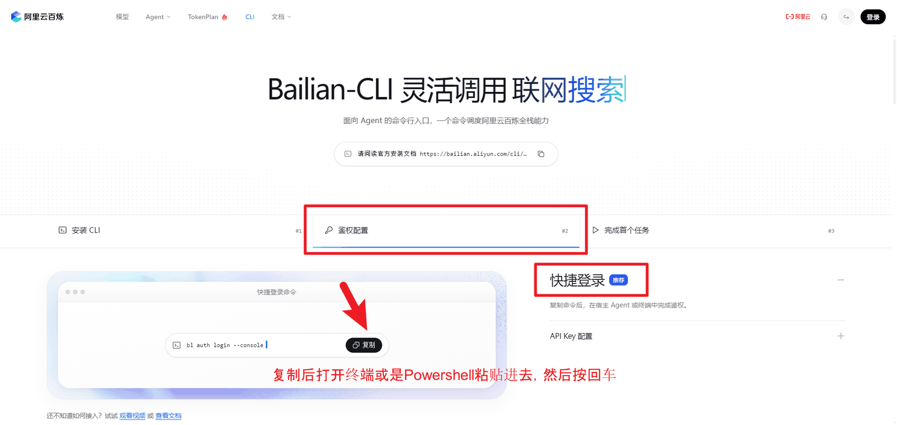
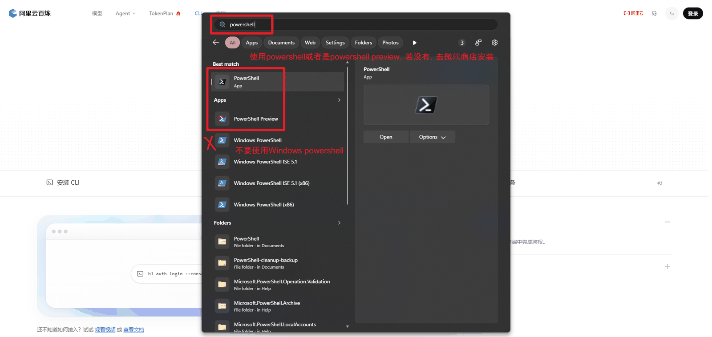
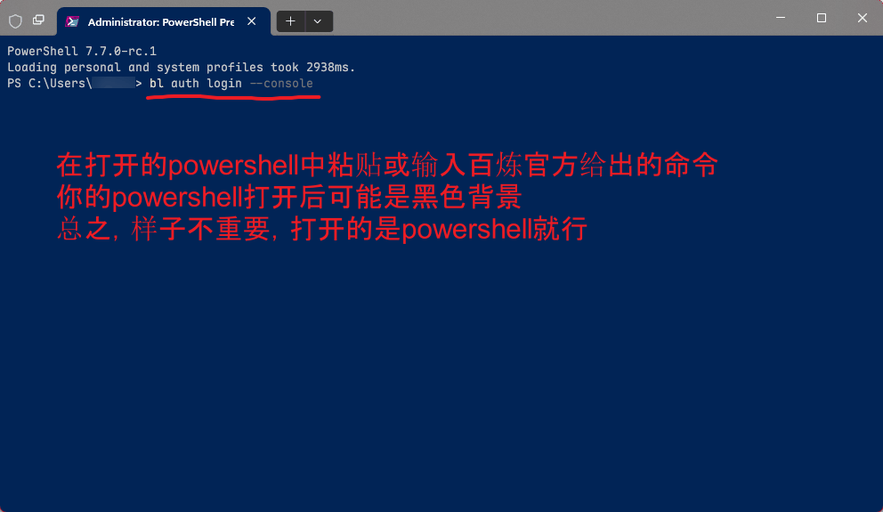
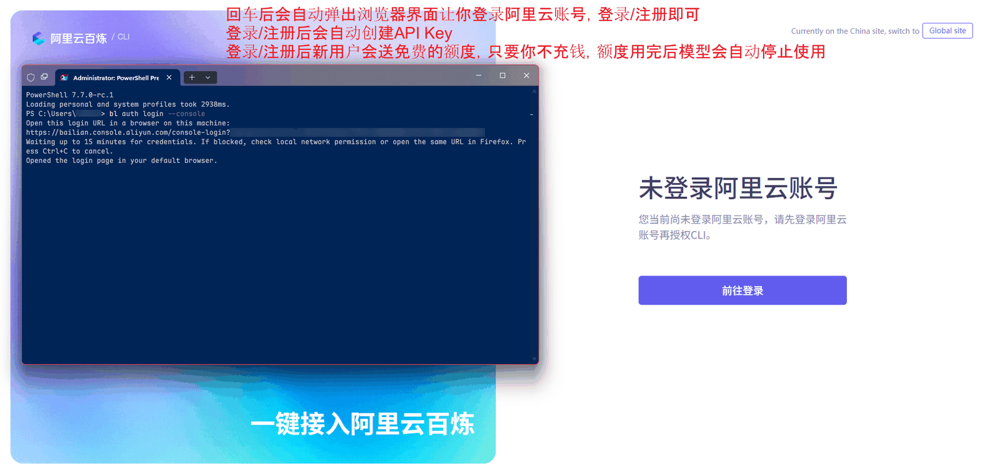
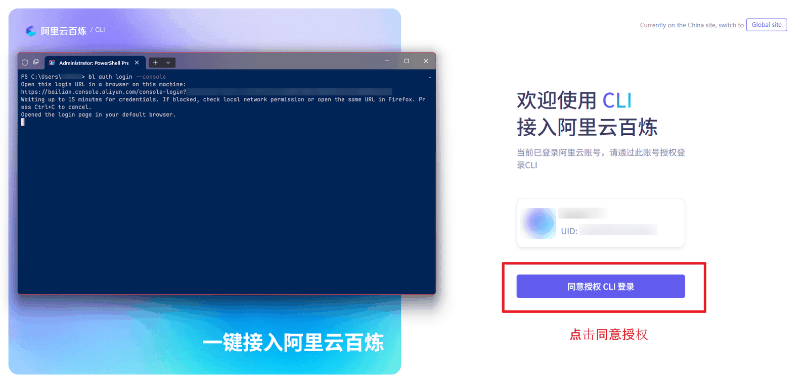
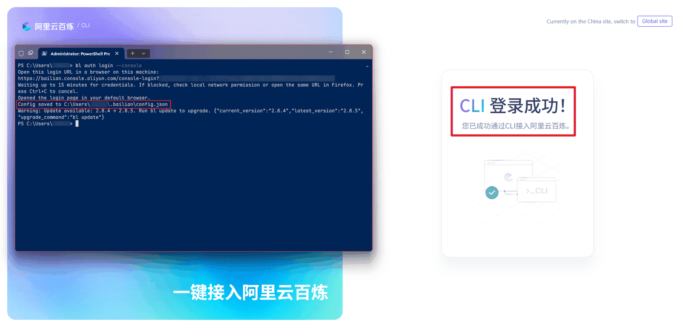
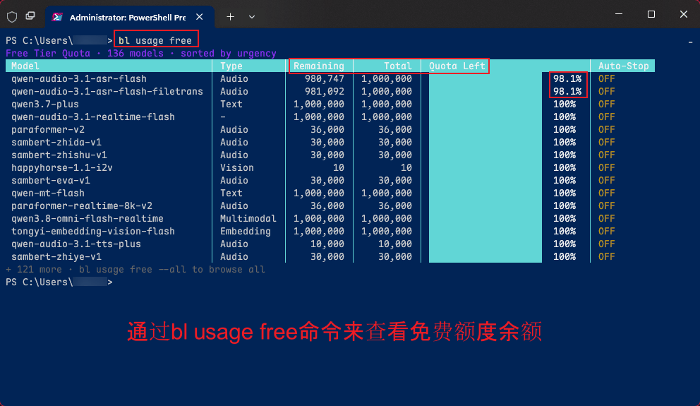

# 英语精读（dsh-increasing-my-english）

[English](README.md) · [更新日志](CHANGELOG.md) · [MIT 许可证](LICENSE)

把播客录音用百炼 `bl speech recognize` 转成分角色文稿，在 DSH 右侧边栏精读；选中单词或句子按 **Ctrl** 查词，点一下收进带音标、释义、例句、词形与词源的生词本。

[](https://www.npmjs.com/package/dsh-increasing-my-english)
[](LICENSE)
[](https://deepseek.com/harness)

需要 DSH **>= 0.2.0**（Web 界面：桌面版或 `dsh web` 均可）。转写需要已登录的百炼 CLI，PDF 导入需要本机 poppler。

## 让 Agent 带你跑起来（推荐）

把下面这段话原样粘贴到一个新的 DSH 对话里发送（工作区选你想放英语材料的文件夹）。助手会读[详细引导](https://github.com/LeeKai233/dsh-increasing-my-english/blob/main/AGENT_ONBOARDING.zh.md)，做完不需要你动手的部分，最后只回你：它做了什么、只剩什么要你做、现在 10 分钟读哪一段。

```text
你是我在 DSH 里的英语精读搭子。先读详细引导
https://raw.githubusercontent.com/LeeKai233/dsh-increasing-my-english/main/AGENT_ONBOARDING.zh.md （如果当前仓库里有
AGENT_ONBOARDING.zh.md，就直接读本地文件），然后照它执行。不需要我动手的你全做；必须我动手时才停。
最后只回三段：你完成了什么、只有我能做什么（写清点哪里）、现在 10 分钟读哪一段。
不要删改我的数据，除了百炼 ASR 和插件查词别外传，不要回显凭据。读不到引导就让我把文件挂载给你。
```

想自己动手？下面的「三步用起来」就是同一套步骤。

## 三步用起来

1. **安装 DSH 桌面版**（DeepSeek 官方）：<https://deepseek.com/harness>。
2. **装插件**：侧栏「插件」→「添加插件」→ 输入 `dsh-increasing-my-english` → 安装并启用。
3. **准备百炼**：注册阿里云百炼，按下一节「百炼 CLI 安装与登录（图文）」装好 `bl` 并登录。

之后打开右侧边栏的「英语精读」面板，等空状态里的「**环境自检**」全绿（需要 `bl` 已登录、Poppler 与工作区都就绪；已有文稿时，打开「转写录音」面板也能看到这张卡），就可以把录音放进 `recordings/` 开始转写了。

## 百炼 CLI 安装与登录（图文）

> 截图来自阿里云百炼控制台的 CLI 页（中国站：<https://bailian.console.aliyun.com/cli>）。控制台界面会随版本更新，按钮位置如有微调，以页面实际内容为准。

### 1. 打开 CLI 页，让 Agent 帮你安装（推荐）

打开 <https://bailian.console.aliyun.com/cli>，在「安装 CLI」里点「**让 Agent 安装（推荐）**」→ 点「复制给 Agent」，把复制的提示词原样粘贴到 **DSH 的新对话**里，让助手识别系统、执行官方安装命令并回报真实的 `bl --version` 校验结果。提示词原文：

```text
请阅读官方安装文档 https://bailian.aliyun.com/cli/install.md，为我安装阿里云百炼 CLI。
先识别操作系统与 Node.js/npm 环境，再按官方文档选择并执行对应的安装命令。
安装后自动执行 bl --version，向我返回真实的版本号和检查结果；若失败，请说明错误原因，不要虚报安装成功。
```


同一页还折叠着「手动安装」，想自己敲命令可以展开对照。

### 2. 复制快捷登录命令

切到「**鉴权配置**」→ 在「**快捷登录（推荐）**」里点「复制」，得到：

```bash
bl auth login --console
```



另一条路是「API Key 配置」（自己把 Key 写进环境变量）；本插件只要求 CLI 已登录，推荐用快捷登录。

### 3. 打开 PowerShell 7

按 Windows 开始菜单，搜索 `powershell`，打开 **PowerShell** 或 **PowerShell Preview**：

- 优先用 PowerShell 7（Windows Terminal 里的 PowerShell）；
- **不要**用旧版 **Windows PowerShell 5.1**（搜索结果里带 "Windows PowerShell" / "ISE 5.1" 的那几个）；
- 没装 PowerShell 7 就去微软商店装一个。终端背景是黑色还是蓝色无所谓。



### 4. 粘贴命令并回车

在 PowerShell 窗口里粘贴第 2 步复制的 `bl auth login --console`，按回车。



### 5. 浏览器登录 / 注册

回车后会自动弹出浏览器让你登录阿里云账号（没有账号就先注册）。登录/注册成功后会自动创建 API Key；新用户有免费额度，只要不充值，额度用完后模型会自动停止使用，不会自动扣费。



### 6. 同意授权

已登录的账号会看到授权页，点「**同意授权 CLI 登录**」。



### 7. 登录成功

终端里出现「CLI 登录成功！」，并把登录凭据保存到 `…\.bailian\config.json`（Windows 下即 `%USERPROFILE%\.bailian\config.json`）。



### 8. 查看免费额度

在终端运行 `bl usage free` 查看各模型的免费额度（`bl usage free --all` 看全部）。本插件转写默认用 `qwen-audio-3.1-asr-flash-filetrans`，转写前可以先在这里确认额度。



### 零命令行路径

不想碰终端也可以：开一个新对话，对助手说「**帮我安装百炼 CLI**」「**帮我登录百炼 CLI**」。助手会用后台终端跑官方安装与 `bl auth login --console`，等浏览器弹出后你只负责完成登录与「同意授权」，最后让助手回报 `bl --version` 与登录状态即可。面板的「环境自检」也会复核结果。

## 国内网络

| 环节 | 建议 |
|---|---|
| 安装 DSH 插件 | 插件页会自动在 `registry.npmjs.org` 与 `registry.npmmirror.com` 之间挑更快的源。新发布的包在 npmmirror 首次同步可能有 5–10 分钟延迟；刚发布就提示找不到时，等几分钟再装即可。 |
| 百炼 CLI `bl` | 用百炼中国站的官方安装文档/脚本（<https://bailian.console.aliyun.com/cli>），不要走第三方镜像。 |
| poppler（PDF 导入） | 推荐 `winget install -e --id oschwartz10612.Poppler`；已经装过 poppler 的，可以用环境变量 `DSH_ENGLISH_PDFTOPPM` / `DSH_ENGLISH_PDFTOTEXT` 指向已有的 `pdftoppm.exe` / `pdftotext.exe`。 |
| GitHub | 只有开发者需要用（源码、Issues、Release 说明）；普通用户装插件与登录 CLI 都不依赖直连 GitHub。 |

## 功能

### 转写录音

- 把音频放进工作区的 `recordings/`（mp3 / m4a / wav / aac / flac / ogg / opus / amr / wma / mp4 / webm）。
- 面板「转写录音」里选文件：默认列出 `recordings/`；也可以粘贴**任意文件夹或音频文件的绝对路径**后点「扫描」，或用「选择文件夹…」调系统目录选择器；再选「模型」（默认 `qwen-audio-3.1-asr-flash-filetrans`，列表由 Host 提供）、可选填说话人数（始终启用说话人分离），点「开始转写」。转写在后台运行，通常 1–3 分钟，完成后文稿自动出现。
- 也可以直接在对话里说「转写 recordings/xxx.m4a」或给出绝对路径，助手会调用 `english_transcribe` 工具并等它完成。
- 默认模型 `qwen-audio-3.1-asr-flash-filetrans`，失败会自动回退 `fun-asr`，回退信息记录在文稿的 `warnings` 里。

### 阅读文稿

- 打开方式：会话头部工具条上的**耳机按钮**（悬停提示「打开英语精读」），或右侧栏 guide 里的「英语精读」卡片。面板顶部是「文稿 / 生词本」两个视图切换和字号 **A− / A+**（12–20px，「文稿」与「生词本」各自记住上次的值）。
- 有文稿时，顶部下拉框（「选择文稿」）可切换；文稿按说话人分段、每段带时间戳。
- 导入的文稿没有说话人和时间戳，也不显示「合并短句」；PDF 文稿顶部还有缩放（+ / −，记住上次比例）与「DSH 预览」按钮，可在 DSH 里打开原 PDF。

### 划词查词

- 在文稿里选中**单词/短语（≤4 个词）**或**句子**，按 **Ctrl**（macOS 用 **⌘**）：
  - 单词/短语：浮窗显示音标 + 1–3 条中文释义（词形与词源在加入生词本后的词条卡片里查看）；
  - 句子：浮窗只显示中文翻译。
- 已收进生词本的词/短语在文稿中带**虚线**标记；再次选中时浮窗直接使用生词本里的音标与释义（句子用已保存的翻译），**不再调用模型**。新词的查询结果会写入 `.dsh-english/lookup-cache.json`，下次命中缓存。

### 生词本

- 点浮窗右上角按钮加入生词本，重复内容不会重复入库；查词失败的条目以「待补全」入库，稍后可以补。
- 单词条目会自动带上：
  - **词形**：不同词性（名词/动词/形容词/副词…）与不规则形式（过去式、过去分词、复数、比较级、最高级、现在分词、第三人称单数等），**最多 8 条**；
  - **词源**：来源语言 + 词根/词缀拆解（例如 nostalgia = 希腊语 nostos「返乡」+ algos「痛苦」）+ 一段中文词源说明。
- 老词条没有这些字段时，卡片上会出现「**补全词形/词源**」按钮，点一下重新查询并补全（对应 HTTP action `vocab.enrich` 与工具 `action=enrich`）。
- 生词本视图支持搜索、按「单词 / 句子」过滤、按文稿筛选、排序（时间 / A–Z）、详情「全 / 简」与删除；有「待补全」条目时顶部会出现提示条和「复制补全提示」按钮——把提示词粘贴到对话里，助手就会用 `english_vocab` 读 pending 条目并写回音标、释义与例句翻译。
- `vocab/生词本.md` 是每次变更后自动重写的可读导出。

### PDF 导入

- 「导入文稿」支持 `.txt` / `.text` / `.md` / `.markdown` / `.html` / `.htm` / `.tex` / `.rst` / `.log`（≤3MB）和 `.pdf`（≤20MB，默认最多渲染 120 页）。
- HTML 去标签、Markdown 去标记、TeX 去命令但**保留 `$…$` 公式**（侧边栏渲染上下标、分数、根号）。
- PDF 在侧边栏按页显示：本机 `pdftoppm` 渲染页面图 + `pdftotext -bbox` 生成词坐标文本层，可以像普通文稿一样划词按 Ctrl 查词，已收录词同样有虚线标记。
- **PDF 导入依赖 poppler**（`pdftoppm` / `pdftotext`）。没装时导入会失败，「环境自检」卡会提示 `winget install -e --id oschwartz10612.Poppler`。

### 合并短句 / 删除

- 「合并短句」（仅转写稿）：同一说话人、停顿不超过 `asr.mergeGapMs`（默认 4000ms）的相邻短句合并成段；转写时也会自动应用。
- 「删除」需要再点一次「确认」；只删 `transcripts/<name>.json`、对应的任务记录与 PDF 页缓存，**不会删除你的录音文件**。

### 环境自检

- 在**没有文稿的空状态**或打开「转写录音」面板时会出现「环境自检」卡（数据来自 `env.check`，不做本机探测）。卡片默认折叠，只有检测到问题时才自动展开一次；点标题可手动展开/收起。
- 三个状态 chip：`bl`（正常 / 未安装 / 未登录，展开后显示版本号）、`PDF`（正常 / 未安装，即 Poppler）、`工作区`（正常 / 不可写）。
- 展开后显示 `bl`、`PDF 工具 (Poppler)`、`工作区` 详情，`transcripts` / `vocab` / `recordings` 三个目录状态与可写性，「提示」（warnings）列表，以及「重新检测」按钮。
- 命令按缺失项给出、可一键复制（不缺失就不显示）：`bl` 未安装 → `npm i -g bailian-cli --registry=https://registry.npmmirror.com`；`bl` 未登录 → `bl auth login --console`；Poppler 缺失 → `winget install -e --id oschwartz10612.Poppler`（Linux / macOS 用 `brew install poppler` / `sudo apt install poppler-utils`）。装好后点「重新检测」。注意：**Poppler 只影响 PDF 导入**——没装 Poppler 时转写与查词照常可用，但自检不会全绿（`PDF` chip 显示「未安装」）。

## 工作区数据布局

```
<工作区>/
  recordings/                     你放外部录音（插件只读）
  transcripts/<name>.json         归一化文稿（分段 + 毫秒时间戳）
  transcripts/.jobs/<id>.json     转写任务状态（每 15s 心跳，超 90s 未更新视为中断）
  transcripts/.jobs/<id>.raw.json 原始 ASR 结果
  vocab/vocabulary.json           生词本数据源（单词 + 句子两种条目）
  vocab/生词本.md                 每次变更后自动重写导出
  .dsh-english/config.json        可选：覆盖默认配置（见下）
  .dsh-english/lookup-cache.json  查词缓存
  .dsh-english/pdfs/<uuid>/       PDF 导入缓存（source.pdf / page-XX.png / words.xml）
```

数据格式为 `version: 1` 并保持冻结（只允许新增可选字段）；JSON 损坏时会备份成 `*.corrupt-<时间戳>` 再按默认值继续。

## 配置

`.dsh-english/config.json` 可选，不存在时使用默认值：

```json
{
  "asr": {
    "model": "qwen-audio-3.1-asr-flash-filetrans",
    "fallbackModel": "fun-asr",
    "language": "en",
    "maxJobMinutes": 30,
    "pollIntervalSeconds": 2,
    "mergeGapMs": 4000,
    "toolTimeoutMinutes": 32
  },
  "lookup": {
    "backend": "ds",
    "provider": null,
    "model": null,
    "timeoutMs": 20000
  },
  "import": {
    "maxPdfPages": 120,
    "dpi": 100
  },
  "dirs": {
    "recordings": "recordings",
    "transcripts": "transcripts"
  }
}
```

配置由 Host 缓存约 2 秒：保存后稍等片刻即生效，不需要重启 DSH。

| 键 | 默认 | 说明 |
|---|---|---|
| `asr.model` | `qwen-audio-3.1-asr-flash-filetrans` | 默认转写模型 |
| `asr.fallbackModel` | `fun-asr` | 主模型失败后回退；空字符串表示不回退 |
| `asr.language` | `en` | 语言提示（如 `zh`） |
| `asr.maxJobMinutes` | 30 | 单个转写任务的最长运行时间 |
| `asr.pollIntervalSeconds` | 2 | `bl speech recognize` 的轮询间隔 |
| `asr.mergeGapMs` | 4000 | 同说话人相邻短句的自动合并阈值 |
| `asr.toolTimeoutMinutes` | 32 | `english_transcribe` 工具的整体超时，必须大于 `maxJobMinutes` |
| `lookup.backend` | `ds` | `ds`（DSH 当前模型，快、不占百炼文本额度）/ `bl`（`bl text chat`）/ `off` |
| `lookup.provider` / `lookup.model` | `null` | 覆盖查词使用的模型；`null` 表示跟随 DSH 当前默认模型 |
| `lookup.timeoutMs` | 20000 | 单次查词超时（毫秒） |
| `import.maxPdfPages` | 120 | PDF 导入最多渲染的页数 |
| `import.dpi` | 100 | PDF 页面渲染分辨率 |
| `dirs.recordings` / `dirs.transcripts` | `recordings` / `transcripts` | 工作区内的相对目录 |

**可执行路径不进配置文件。** `config.json` 在工作区里、可被写工作区的进程修改，为避免把配置变成执行入口，`bl`、`pdftoppm`、`pdftotext` 只能通过**只读环境变量**覆盖（值必须是绝对路径或纯命令名，不允许空格、参数或 shell 元字符）：

| 环境变量 | 默认命令 | 说明 |
|---|---|---|
| `DSH_ENGLISH_BL` | `bl` | 百炼 CLI |
| `DSH_ENGLISH_PDFTOPPM` | `pdftoppm` | PDF 页图渲染（poppler） |
| `DSH_ENGLISH_PDFTOTEXT` | `pdftotext` | PDF 词坐标文本层（poppler） |

旧版的 `blPath`、`import.pdfToPpmPath`、`import.pdfToTextPath` 已移除：出现时会被忽略，并在环境自检的 warnings 里提示改用对应环境变量。未知键一律忽略；非法值回退默认值并给出 warning。Linux / macOS 上 poppler 可用 `brew install poppler` 或 `sudo apt install poppler-utils`。

## 助手工具

- `english_transcribe { audio, speakers?, model?, language? }`：转写并等待完成，返回 `{ok,jobId,transcript,segments,speakers,durationMs,model,warnings,state,error?}`。`audio` 用工作区相对路径或绝对路径；失败时给出可操作信息（`bl` 缺失/未登录时附安装或登录命令）。
- `english_vocab { action, ... }`：`action` 取 `list`（默认只列待补全条目）/ `lookup` / `add` / `update` / `enrich` / `remove` / `export`。
  - `list` 默认列 pending；`update` 用于助手自己补全音标/释义/例句翻译；`enrich` 按 id 重新查询词形与词源；`export` 重写 `vocab/生词本.md`。
- 面板与助手走同一套 Host 实现：面板的动作（文稿列表、转写、查词、生词本等）走插件自建的 `POST /dsh-english/api`（只接受回环地址与同源页面，要求 `x-english-practice: 1` 请求头），文稿正文经宿主 workspaceFiles 接口读取；助手通过上面两个工具调用。

## FAQ

**转写报错找不到 `bl` / 提示未登录怎么办？**
错误码是 `bl/missing` 或 `bl/not-authenticated`。「环境自检」卡（没有文稿时的空状态，或打开「转写录音」面板时可见）会指出具体缺哪一步。手动修复：`npm i -g bailian-cli --registry=https://registry.npmmirror.com` 安装，`bl auth login --console` 登录，`bl auth status` 复查。装完新命令后重启 DSH，让进程拿到新的 `PATH`。其他常见错误码：`pdf/poppler-missing`（缺 poppler）、`http/rate-limited`（操作太频繁）、`config/invalid`（配置读不了）。

**PDF 导入报 `pdf/poppler-missing`？**
安装 poppler：`winget install -e --id oschwartz10612.Poppler`；已装在非默认目录就设置 `DSH_ENGLISH_PDFTOPPM` / `DSH_ENGLISH_PDFTOTEXT`。装完重启 DSH。

**Windows 上路径怎么写？**
用绝对路径，例如 `D:\Podcasts\ep12.m4a`。带空格的路径直接粘贴到「扫描」输入框即可，不需要加引号，反斜杠也不用转义。

**会花多少钱？**
转写调用百炼语音识别，按其价格计费；音频会先上传到百炼临时存储（保留 48h）。新用户可用 `bl usage free` 查看免费额度，不充值则额度用完后自动停用。默认查词走 DSH 当前模型（`ctx.llm`），不额外消耗百炼文本额度；只有 `lookup.backend = "bl"` 时查词才走百炼文本模型。

**为什么有的词查词/生词本没有释义？**
查词失败时会以「待补全」入库。点卡片上的「补全词形/词源」，或在对话里说「补全生词本」让助手补。

**插件、数据、隐私？**
不收集任何遥测。文稿、生词本、缓存都在你当前工作区的普通文件里，可随时备份或搬走。HTTP 接口只监听回环地址、只接受同源请求，并带自定义请求头。

**卸载 / 换源？**
桌面版的插件行由 Electron profile 独占：在插件页「移除」再「添加」即可，不要手工改插件 manifest；移除插件不会删你的工作区数据。

## 仓库结构

| 路径 | 说明 |
|---|---|
| `index.js` | 插件入口：`name` / `inject` / `apply(ctx)` 只做组装（约 17 行） |
| `host/` | Host 半，12 个模块：`api` / `asr` / `config` / `env` / `json-store` / `lookup` / `paths` / `pdf` / `text` / `tools` / `transcript` / `vocab` |
| `client.js` | Client 半，单文件 `window.__ModuleLoader__.load` bundle（§0–§9 分区） |
| `cordis.patch.yml` | 插件 bundle patch（insert id `english-practice`） |
| `locale/{zh,en}.json` | 插件页展示元数据（标题 / 描述） |
| `icon.svg` | 插件页图标 |
| `assets/bailian-cli/` | README 图文（8 张 PNG） |
| `tests/` | `node --test` 单测 + 契约 + 集成测试（10 个 `*.test.mjs`） |
| `AGENTS.md` | 维护者契约：架构决策、冻结接口、发布流程 |
| `README.md` / `README.zh.md` | 英文 / 中文文档 |
| `CHANGELOG.md` | 更新日志（Keep a Changelog） |
| `LICENSE` | MIT |
| `whalepicks.json` | 鲸选（whale-picks）商店清单，schemaVersion 1.1 |
| `.github/workflows/ci.yml` | CI：`node --check` 两个入口 + `node --test`（Node 22，无需 npm install） |

npm 发布内容以 `package.json#files` 为准：`index.js`、`host/`、`client.js`、`cordis.patch.yml`、`locale/*.json`、`icon.svg`、`assets/`、`README.md`、`README.zh.md`、`CHANGELOG.md`（`package.json` 与 `LICENSE` 由 npm 自动附带；`tests/`、`AGENTS.md`、`whalepicks.json`、`.github/` 不随包发布）。

## 开发备注

- **零构建**：Host 半是 Node ESM（`index.js` 只做组装 + `host/` 下 12 个模块），Client 半是手写的单文件 `client.js`（`window.__ModuleLoader__.load` bundle，§0–§9 分区）。没有 TypeScript、没有打包器、没有运行时依赖。
- **改 Host**：DSH 重启后生效（桌面版退出重开；CLI / `dsh web` 重启进程）。
- **改 Client**：刷新页面即可（bundle 按包解析，内容变化后页面会重新拉取）。
- **改 `package.json` 的 `dsh` 清单或 `cordis.patch.yml`**：需要重启 DSH。
- **自检**：`npm run check`（`node --check index.js` + `node --check client.js` + `node --test` 自动发现 `tests/*.test.mjs`），需要 **Node 20+**；当前 10 个测试文件（单测 + 契约 + 集成）全绿。
- **本地开发**：`package.json` 开发期保持 `@local/dsh-english-practice`，桌面 profile 以 `link:` 安装；发布时统一改名 `dsh-increasing-my-english`（`package.json`、`cordis.patch.yml`、`client.js` 的 PKG 与 loader id、locale meta）。
- **稳定标识（不要改）**：`.dsh-english/`、`/dsh-english/api`、`x-english-practice` 请求头、工具名 `english_transcribe` / `english_vocab`、tab kind `english-reader`、locale NS `englishPractice`、patch 行 id `english-practice`。

## 许可证

[MIT](LICENSE) © 2026 LeeKai233
